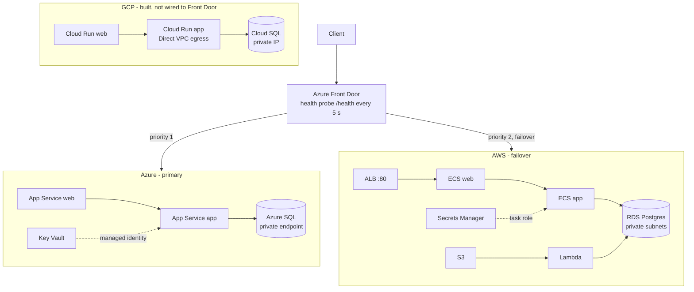

# Multi-cloud DR: Azure primary, AWS failover

A two-tier web app (web + app + Postgres/SQL) built with Terraform on Azure, AWS and GCP. Azure Front Door sends traffic to Azure and fails over to AWS automatically when Azure's health probe fails. GCP is built as a third, optional origin.

## Architecture



| | Azure | AWS | GCP |
|---|---|---|---|
| Web / app compute | App Service (containers) | ECS Fargate | Cloud Run |
| Database | Azure SQL, private endpoint | RDS Postgres, private subnets | Cloud SQL, private IP |
| Secrets | Key Vault, read via managed identity | Secrets Manager, read via task role | Secret Manager, read via service account |
| Network isolation | VNet, 3 subnets, NSGs | VPC, 2 public + 2 private subnets, security groups | VPC, Direct VPC egress |
| Terraform state | Azure Storage | S3 | GCS |

## Failover drill (Azure → AWS)

Azure was taken down while a loop curled the Front Door URL.

| Event | Time to switch |
|---|---|
| Failover (Azure unhealthy → AWS serves) | 96 s |
| Failback (Azure healthy again → Azure serves) | 85 s |

The response body names the serving cloud, so each switch is visible in the loop output. See [`docs/failover-drill.md`](docs/failover-drill.md) for the logged excerpt.

## CI/CD

GitHub Actions, no cloud keys stored anywhere:

- `ci.yml`: `terraform fmt -check` and `validate` for all three clouds, plus Checkov (soft-fail).
- `plan-aws.yml`, `plan-azure.yml`, `plan-gcp.yml`: `terraform plan` on every PR touching that cloud's folder, authenticated with OIDC (AWS role, Azure federated credential, GCP workload identity federation). Each run gets short-lived credentials and only this repository can obtain them.
- Apply is deliberately not automated: merging must not create billable infrastructure.

## Decisions and tradeoffs

- **Three clouds, one pattern.** Same shape on each (web → app → private database, secret from the cloud's secret store) so the differences are the lesson, not the app.
- **Front Door Standard over DNS failover.** Health-probe-based failover in seconds-to-minutes with no DNS TTL to wait on.
- **HTTP to the origins.** The ALB has no certificate, so Front Door forwards over HTTP and the Azure web app has `https_only = false`. A production build would put certificates on both origins.
- **No cross-cloud data replication.** The failover target serves the app but its database is independent, so RPO is not measured and not met. Replication was out of scope for this build.
- **Plan on PR, manual apply.** Keeps a green PR check as the proof of the pipeline without paying for infrastructure on every merge.
- **OIDC everywhere.** No long-lived keys; trust is scoped to this repo.
- **Cost control.** Everything is destroyed after each session; the pipeline was proven, then the state stores were removed.

## Known limitations

- Database passwords generated by Terraform exist in state on AWS and GCP. A production setup would use managed credentials or rotation.
- The Azure app tier is reachable from the internet; a private endpoint would close this.
- The Lambda connects to RDS with SSL required but without certificate verification.
- The AWS state bucket name embeds the account ID.
- Terraform state stores have been deleted, so the plan workflows no longer run. The code and the green PR runs are the record.

## Repository layout

```
terraform/aws/     VPC, ECS, ALB, RDS, Secrets Manager, S3 + Lambda
terraform/azure/   VNet, App Service, Azure SQL, Key Vault, Front Door
terraform/gcp/     VPC, Cloud Run, Cloud SQL, Secret Manager
.github/workflows/ ci.yml, plan-aws.yml, plan-azure.yml, plan-gcp.yml
docs/              failover-drill.md
```
